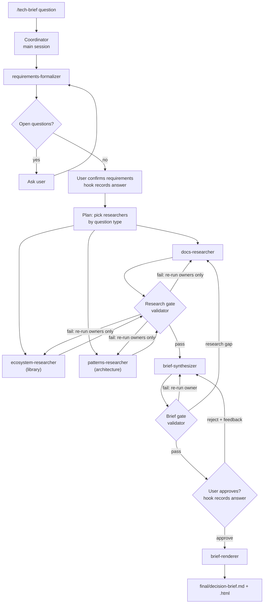

# tech-decision-brief

An agentic workflow for [Claude Code](https://code.claude.com) that turns a technology
question into a cited **Tech Decision Brief** in Markdown and HTML.

```
/tech-brief Should our .NET 8 API use Hangfire or Quartz.NET for background jobs? SQL Server, recurring jobs.
```

A coordinator asks for whatever is missing, has you confirm the requirements, picks
research subagents for the question type, runs them in parallel against official docs
(Microsoft Learn and Context7 MCP servers, plus the web), checks every artifact against
quality gates with targeted retries, drafts the brief, and writes the final output only
after you approve it. Interrupted runs resume where they stopped.

## Prerequisites

| | Version | Notes |
|---|---|---|
| [Claude Code](https://code.claude.com) | 2.1.270 or later (tested with 2.1.296) | Signed in. Your plan must offer **Sonnet** and **Haiku**. |
| Node.js | 20 or later | Runs the hooks and scripts (plain `.mjs`, no npm install). `node` must be on `PATH`. |
| Git | any recent | On Windows, Git for Windows: Claude Code runs hooks through Git Bash. |
| Internet access | | To `learn.microsoft.com`, `mcp.context7.com` and the web. |

**No API keys or secrets are needed.** Both MCP servers are remote and keyless, and Claude
Code uses your own login. See [.env.example](.env.example) for details.
Nothing reads a `.env` file.

## Setup

```bash
git clone https://github.com/matsvei-arshynski/tech-decision-brief.git
cd tech-decision-brief
claude
```

On first start, Claude Code asks you to **trust the folder**: accept, because the hooks and
MCP servers in `.claude/` and `.mcp.json` only load in a trusted folder. Both MCP servers
are enabled by `.claude/settings.json`. Run `/mcp` to check that `microsoft-learn` and
`context7` are connected.

`.claude/settings.json` also sets the session model to Sonnet with medium effort. To use
something else for yourself only, override it in `.claude/settings.local.json` (git-ignored).

## Run

Start Claude Code **in this folder** and type:

```
/tech-brief <your question, with any constraints you already know>
```

Then:
1. Answer the clarifying questions, if any, and **confirm** the requirements.
2. Wait while research runs: usually 2–4 minutes.
3. Review the draft summary and **Approve**, or **Reject** with what should change. Rejected
   drafts are revised, re-checked and shown again.

Output lands in `runs/<YYYYMMDD-HHMM>-<slug>/final/`:
`decision-brief.md` and `decision-brief.html` (self-contained, light and dark themes).

A run takes about 10–20 minutes, most of it research. Every run folder keeps all its
intermediate artifacts, gate reports, approval records and `workflow-state.json`.

## Resume

If a session is interrupted (closed terminal, crash, Ctrl+C), start Claude Code again in
this folder and run:

```
/tech-brief --resume                 # newest unfinished run
/tech-brief --resume <run-id>        # a specific run, e.g. 20261012-2103-express5-vs-fastify-node22
```

Resume re-checks every artifact against its recorded hash and keeps all valid work. It
relaunches only what is missing or invalid, then continues normally. Files you edited by
hand are kept, but they must pass their gates (and, for the brief, approval) again.

A run that stopped as **blocked** (a retry limit was reached) resumes once you change the
requirements: the coordinator asks what to change.

Each run folder has an append-only `events.jsonl`: engine decisions, subagent launches,
artifact writes, gate results, approvals and guard blocks, each with the Claude Code
session id. An interruption shows up as a change of session id. Runs recorded before the
log existed don't have one.

## Sample runs

Five committed runs show different paths through the workflow. Each folder has the
request, requirements, plan, research, gate reports, approval records, state and final brief.

| Run | Question | What it shows | Outcome |
|---|---|---|---|
| [`20261012-2103-express5-…`](runs/20261012-2103-express5-vs-fastify-node22/final/decision-brief.md) | Express 5 vs Fastify (library) | Two Q&A rounds; `--simulate-fault CITATIONS:ecosystem`: injected gate failure → only that researcher re-runs → pass; **session killed during synthesis → `--resume`** relaunches only the synthesizer | Express 5, low confidence |
| [`20261012-2119-async-python-…`](runs/20261012-2119-async-python-http-client-choice/final/decision-brief.md) | httpx vs aiohttp (library) | Run from a **fresh clone following only this README**: every gate passes first time, no retries | httpx, medium confidence |
| [`20261012-2154-azure-…`](runs/20261012-2154-azure-messaging-service-bus-event-grid/final/decision-brief.md) | Service Bus vs Event Grid vs Event Hubs (architecture) | `patterns-researcher` selected instead of ecosystem; Microsoft Learn MCP; **session killed during research → `--resume`**. [`events.jsonl`](runs/20261012-2154-azure-messaging-service-bus-event-grid/events.jsonl) shows the session change and the researchers relaunched | Event Hubs, high confidence |
| [`20261012-2204-nodejs-logging-…`](runs/20261012-2204-nodejs-logging-pino-vs-winston/gates/UNRESOLVED.md) | pino vs winston (library) | `--simulate-fault CITATIONS:ecosystem:always`: four research-gate rounds, each re-running only the ecosystem researcher, then the run **stops as `blocked`**; no brief is drafted; [`UNRESOLVED.md`](runs/20261012-2204-nodejs-logging-pino-vs-winston/gates/UNRESOLVED.md) reports the open finding | Blocked (by design) |
| [`20261012-2216-typer-…`](runs/20261012-2216-typer-vs-click-python-cli/final/decision-brief.md) | Typer vs Click (library) | **Reject → feedback → revise → approve**: the rejection and the feedback are in [`approval/brief.r1.json`](runs/20261012-2216-typer-vs-click-python-cli/approval/brief.r1.json); the revised draft passes a fresh brief gate, is approved (`brief.r2.json`), then rendered | Typer, medium confidence |

Runs 3–5 have an `events.jsonl`; runs 1 and 2 were recorded before the event log existed.

### Testing the failure path

`--simulate-fault <GATE>:<artifact>` makes one script gate fail on attempt 1 of one
artifact, so the gate → targeted retry → re-check loop can be seen on demand:

```
/tech-brief <question> --simulate-fault CITATIONS:ecosystem
```

`GATE` is `STRUCTURE` or `CITATIONS`; `artifact` is `requirements`, `docs`, `ecosystem`,
`patterns` or `brief`. The failure is labelled `[injected]` in the gate report. Add
`:always` (for example `CITATIONS:ecosystem:always`) to fail every attempt instead: the
gate pass runs out of rounds and the run stops as `blocked`, with `gates/UNRESOLVED.md`.

## Tests

```bash
node --test
```

About 20 tests (under a minute) run the real CLIs and hook scripts in a throwaway folder,
using the committed sample runs as fixtures:
- exact launches and the launch guard;
- Q&A and change requests;
- targeted retry, and research gaps found at the brief stage;
- hash-bound approval;
- every retry limit, including `:always` blocking;
- write-time feedback;
- the ownership and shell guards;
- the event log, parallel writes, and the script gates.

They need nothing beyond Node.

## How it works



### Coordinator and the workflow engine

`/tech-brief` ([.claude/commands/tech-brief.md](.claude/commands/tech-brief.md)) runs the
coordinator in your session. It talks to you and launches subagents, but **doesn't decide
the order of work**. The workflow engine ([workflow.mjs](.claude/hooks/lib/workflow.mjs),
called as `node .claude/scripts/state.mjs next <run-id>`) reads the run folder and
`workflow-state.json` and returns the single next step. That includes the exact subagent
launches (agent, attempt, task, findings to fix) and the exact approval questions. The
coordinator loops `next` → do it → `next`. Fresh and resumed runs take the same path, so
the same files always give the same next step.

### Subagents

Each has one job and owns exactly one artifact.

| Agent | Owns | Runs | Model |
|---|---|---|---|
| requirements-formalizer | `01-requirements.md` | always | Haiku |
| docs-researcher | `research/11-docs.md` | always | Haiku |
| ecosystem-researcher | `research/12-ecosystem.md` | library questions | Haiku |
| patterns-researcher | `research/14-patterns.md` | architecture questions | Haiku |
| validator | `gates/<stage>.r<N>.md` | after research and after the brief | Sonnet |
| brief-synthesizer | `30-brief-draft.md` | always | Haiku |
| brief-renderer | `final/decision-brief.{md,html}` | after approval | Haiku |

### Quality gates

| Gate | Checked by | What it checks |
|---|---|---|
| STRUCTURE | script, on every write | Front matter; exact sections in order; one subsection per candidate; one constraint row per hard constraint × candidate; matrix shape, weight order and correct totals |
| CITATIONS | script, on every write | Every claim and every score cites `[Sn]`; every source defined, used and in the fixed format; every brief source comes from the research |
| CURRENCY | validator | Current version and release date (library) or current tiers and limits (architecture), cited |
| CONSTRAINT-COVERAGE | validator | Every hard constraint and criterion has evidence per candidate; the brief follows the research; the recommendation violates no hard constraint, and unknowns lower the confidence |

Script-gate failures go straight back to the agent that wrote the file, which fixes them in
the same attempt. A failed gate report re-runs **only** the owners it names, with their
findings; artifacts downstream of a re-run become `stale` and are regenerated.

**Retry limits:**

| Retry path | Limit |
|---|---|
| A gate pass (research or brief) | 4 rounds: the first check + 3 retries |
| Requirements still failing their script gates | 3 retries |
| Rendering still failing its script gates | 4 render attempts |
| Reject → revise | No cap: you decide when to stop |

When a limit is reached, the run stops as `blocked`, dependent work doesn't start, and
`gates/UNRESOLVED.md` lists every open finding with its owner.

### Approval

Approval and requirements confirmation are asked with marked questions, such as
`[tech-brief:approve run=<id> draft=<sha8>]`. A PostToolUse hook reads **your actual answer
from Claude Code**, not the model's account of it, and writes `approval/<kind>.r<N>.json`,
tied to the hash of the exact file you approved. A PreToolUse hook blocks any write to
`final/` unless the current draft's hash has a valid approval. Editing the draft after
approval closes the gate again.

### Hooks

| Hook | File | Does |
|---|---|---|
| PostToolUse (Write/Edit) | [post_tool_state.mjs](.claude/hooks/post_tool_state.mjs) | Records each artifact's hash, script-gate results and status in state; applies gate reports; marks dependents stale; reports script failures to the writer; logs to `events.jsonl` |
| PostToolUse (AskUserQuestion) | same | Records approvals and feedback |
| PreToolUse (Write/Edit) | [pre_tool_guard.mjs](.claude/hooks/pre_tool_guard.mjs) | Approval gate for `final/` (fails closed); **ownership**: each agent writes only its own artifact and the main session only `00-request.md`; `approval/`, the state file and the event log are hook-only |
| PreToolUse (Bash, PowerShell) | same | A shell command may not mention `final/`, `approval/`, the state file or the event log, unless it is one unchained call of the workflow's own CLI |
| PreToolUse (Agent) | same | A subagent launch must match the engine's expected launch exactly; allowed launches are recorded, and the retry limits count them |

The shell rule is a pattern match, so it can't catch every way a determined shell command
could reach those files. The second layer is `permissions.allow` in
`.claude/settings.json`: it pre-approves only the workflow's own commands, so any other
shell command asks you first. Running Claude Code in a mode that skips permission prompts
removes that second layer.

### Skills

- [`artifact-contract`](.claude/skills/artifact-contract/SKILL.md): file layout, templates,
  citation format, the gates and who fixes what, plus `validate.mjs`. Used by every agent
  that writes, by the validator and by the hooks.
- [`source-research`](.claude/skills/source-research/SKILL.md): order of sources (MCP docs
  first), source quality, citation recording, research budget. Used by every researcher.

### MCP servers

Configured in [.mcp.json](.mcp.json), both remote HTTP and keyless:
**Microsoft Learn** (`microsoft_docs_search`, `microsoft_docs_fetch`, `microsoft_code_sample_search`)
and **Context7** (`resolve-library-id`, `query-docs`). Every source in a brief is tagged
`via mcp:mslearn`, `via mcp:context7` or `via web`.

## Repository layout

```
.claude/
  commands/tech-brief.md        coordinator
  agents/*.md                   7 subagents
  skills/artifact-contract/     templates, validate.mjs, gate rules
  skills/source-research/       research protocol
  hooks/                        pre_tool_guard.mjs, post_tool_state.mjs
  hooks/lib/                    state.mjs (state store), workflow.mjs (engine), approval.mjs
  scripts/state.mjs             CLI: init, next, plan, status, hash
  settings.json                 hooks, permissions, model, MCP enablement
.mcp.json                       MCP servers
CLAUDE.md                       workflow and execution rules (loaded by Claude Code)
runs/                           one folder per run
tests/                          node --test suite
```

## Known limitations and extensions

- **Agent selection is rule-based on the question type.** Library questions get
  docs + ecosystem; architecture questions get docs + patterns. This mirrors the
  reference design, where one transport planner is picked by mode. A natural extension:
  select by the dimensions of the confirmed constraints and criteria, for example a
  license-and-cost researcher when those dimensions appear.
- **The HTML gate checks structure only:** section order, no leftover placeholders, the
  same number of sources as the draft. It doesn't compare the HTML content with the draft.
- **"Same input, same structure" holds by construction**, through fixed templates, file
  names, ordering rules and rule-based agent selection. It isn't tested by running the same
  input twice; the content of a brief varies between runs.

## Troubleshooting

- **Nothing happens after `/tech-brief`, or no hooks run:** start Claude Code from this
  folder and accept the trust prompt. Check `node --version` (20 or later).
- **"Blocked by tech-brief guard: …":** a hook stopped something out of order. The message
  says what's expected; the coordinator normally corrects itself.
- **MCP tools missing:** run `/mcp`, and approve the servers if asked.
- **A run is `blocked`:** read `runs/<id>/gates/UNRESOLVED.md`, then `/tech-brief --resume <id>`
  and describe what to change in the requirements.
- **Inspect a run:** `node .claude/scripts/state.mjs status <run-id>`.
